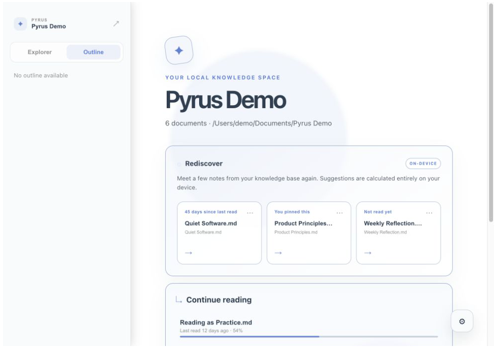
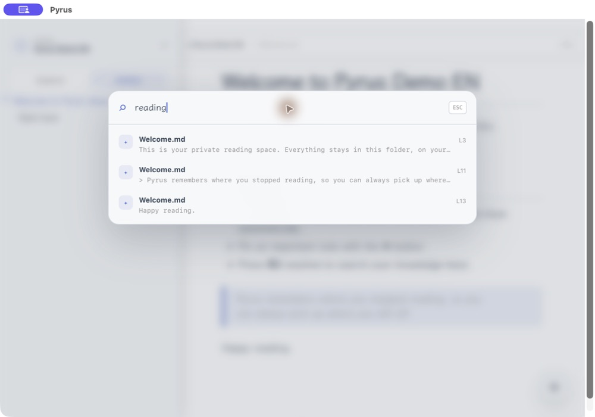
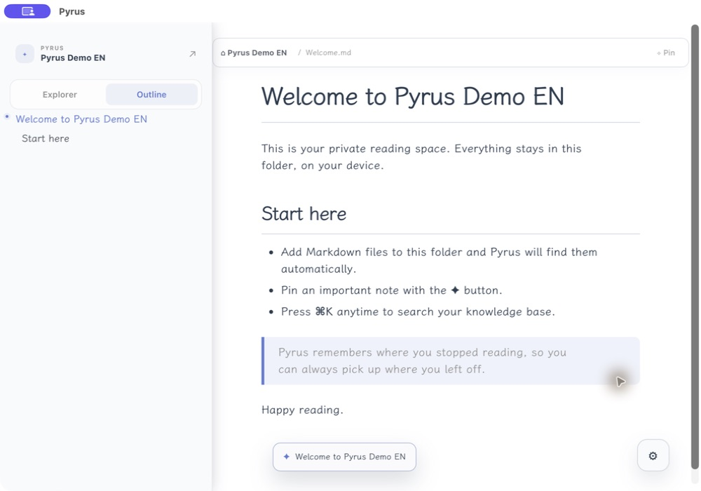
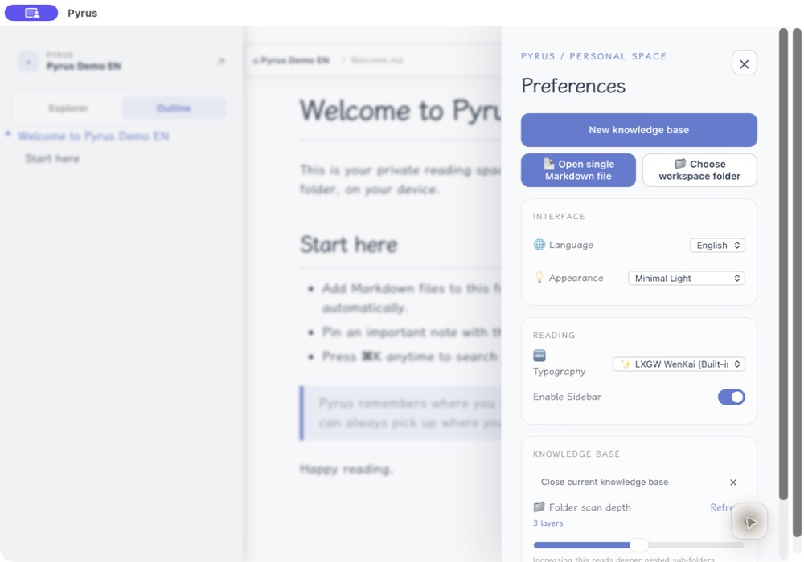

<div align="center">
  
  <h1>Pyrus</h1>
  <p><strong>A calm, local-first Markdown reader for notes, technical docs, and AI-generated drafts.</strong></p>
  <p><strong>English</strong> · <a href="./README_zh-CN.md">简体中文</a></p>
  <p><a href="https://insight4core.github.io/markdown_reader/en/">Website</a> · <a href="https://github.com/Insight4Core/markdown_reader/releases/latest">Download</a></p>
  <p><a href="./docs/RELEASE_NOTES_v0.10.0.md">Latest release notes (0.10.0)</a></p>
</div>

## Why Pyrus

Most Markdown apps want to be an all-in-one editor or cloud workspace. Pyrus stays **read-first and local-first**: open any `.md`, `.markdown`, or `.mdx` file—or a whole folder of notes and AI-generated documents—and read with care, without accounts, cloud sync, or an editor getting in your way.

Everything stays on your device. Original files are never moved, copied, or modified.

## Highlights

### Focused Reading Craft
- **Open anything instantly**: Drop a single Markdown file onto the window, open it from Finder/Explorer, or open a folder as a local knowledge space.
- **Reading tabs**: `⌘`-click (`Ctrl`-click on Windows/Linux) or middle-click any note to open it in a new tab. Each tab keeps its own scroll position and back/forward history, restored per knowledge base after restart.
- **In-page find & global search**: Press `⌘F` / `Ctrl+F` to search and step through matches inside the current note, or `⌘K` / `Ctrl+K` to search titles and content across every linked folder.
- **Responsive typography & 5 themes**: Switch between **Light, Dusk, Paper, Terminal, and Glass**, choose fonts, and fine-tune **font size (14–32px)**, **window-relative reading width**, and **line height**.
- **Rich technical rendering & media lightbox**: Syntax-highlighted code blocks with one-click copy, KaTeX math formulas, callouts, and theme-aware Mermaid diagrams. Click any image or rendered Mermaid diagram to inspect it in a zoomable, pannable lightbox (with a white/black backdrop toggle for transparent PNGs).
- **Seamless external editor handoff**: Jump straight to your preferred external editor (e.g. `code`, `cursor`, `Typora`, or the system default app) or reveal the file in Finder / Explorer. Pyrus watches the file and refreshes automatically when you save.

### Local Workspaces, Recent Changes & Echoes
- **Quick workspace switcher**: Switch between up to 8 recent local folders directly from the sidebar header, restoring each space's own tabs and linked sources.
- **Link without copying**: Attach extra folders or standalone files from anywhere on disk as linked sources—originals stay right where they are.
- **Recent changes**: See notes created or modified in the past 7 days marked as *New*, *Updated*, or *Read*. Files written in the background by AI tools appear automatically.
- **Knowledge Echoes & Today's Echo**: Quiet, on-device resurfacing that connects what you are reading to related older notes and brings one worthwhile note back each day—calculated entirely locally.

### Clean Export & Sharing
- **Export PDF / Print (`⌘P` / `Ctrl+P`)**: Always laid out cleanly on white paper, with long code blocks flowing across pages and captions kept with their tables and images.
- **Copy as rich text or Markdown**: Copy formatted HTML (with inlined styles and rasterized diagrams for email/docs) or raw Markdown in one click.

## Preview

| Rediscover & workspace home | Find anything with `⌘K` |
| --- | --- |
|  |  |

| Focused reading | Preferences |
| --- | --- |
|  |  |

## Keyboard Shortcuts

| Action | macOS | Windows / Linux |
| --- | --- | --- |
| Find in current note | `⌘F` | `Ctrl+F` |
| Global search | `⌘K` | `Ctrl+K` |
| New tab / Close tab | `⌘T` / `⌘W` | `Ctrl+T` / `Ctrl+W` |
| Switch tabs | `⌘1–9` / `⇧⌘[` `⇧⌘]` | `Ctrl+1–9` / `Ctrl+Tab` |
| Toggle sidebar | `⌘\` | `Ctrl+\` |
| Back / Forward in reading history | `⌥←` / `⌥→` | `Alt+←` / `Alt+→` |
| Export PDF / Print | `⌘P` | `Ctrl+P` |

## Getting Started

1. Launch Pyrus.
2. Drop any `.md` / `.markdown` / `.mdx` file to read immediately, or choose **Open knowledge base** / **New knowledge base** to work with a folder.
3. Use the sidebar switcher to jump between recent folders, `⌘F` / `⌘K` to locate passages, and the top toolbar to open in your external editor or export when done.

## Download

Download the latest macOS, Windows, or Linux build from [GitHub Releases](https://github.com/Insight4Core/markdown_reader/releases/latest).

## Feedback

Use **Send feedback** in Preferences, or open a [GitHub issue](https://github.com/Insight4Core/markdown_reader/issues) to share an idea or report a bug.

## Development

Requirements: Node.js, Rust, and platform prerequisites for Tauri 2.

```bash
git clone https://github.com/Insight4Core/markdown_reader.git
cd markdown_reader
npm install
npm run tauri dev
```

Run tests:

```bash
node --test tests/*.test.mjs
cd src-tauri && cargo test
```

## License

MIT
