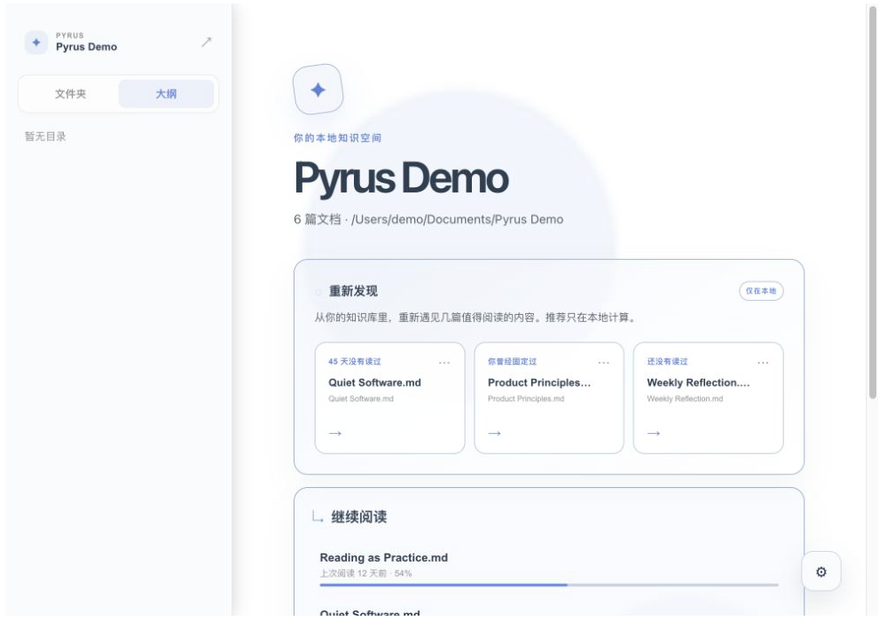
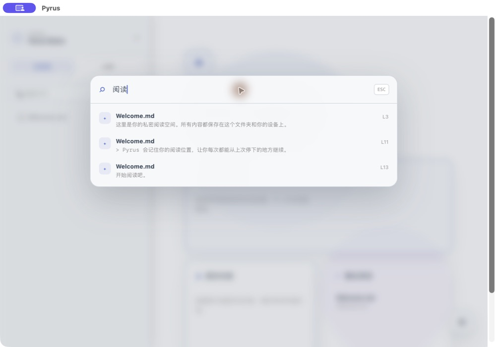
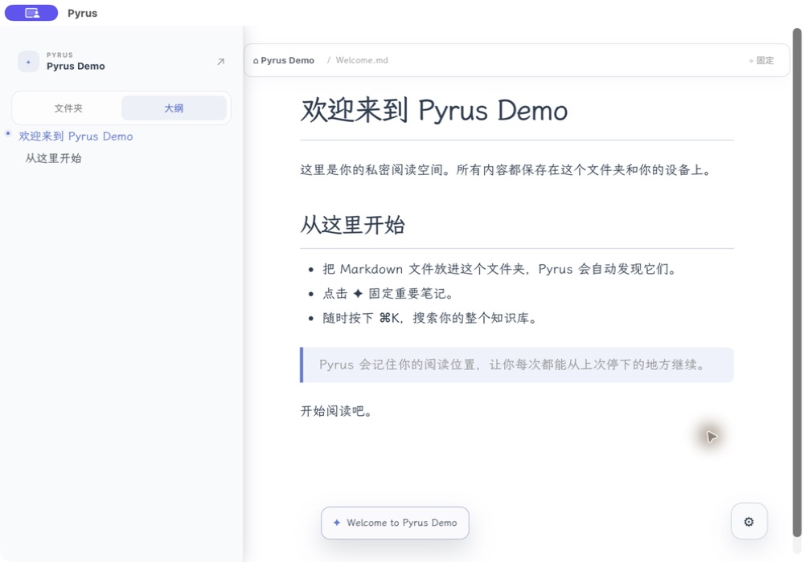

<div align="center">
  
  <h1>知返 / Pyrus</h1>
  <p><strong>一个专注、本地优先的跨平台 Markdown 阅读器与知识空间。</strong></p>
  <p><a href="./README.md">English</a> · <strong>简体中文</strong></p>
  <p><a href="https://insight4core.github.io/markdown_reader/zh-cn/">官方网站</a> · <a href="https://github.com/Insight4Core/markdown_reader/releases/latest">下载</a></p>
  <p><a href="./docs/RELEASE_NOTES_v0.10.0.md">查看最近更新说明（0.10.0）</a></p>
</div>

## 为什么做知返

绝大多数 Markdown 工具都在往重型编辑器或云端平台膨胀，而知返始终坚持 **只读优先（Read-first）与本地优先（Local-first）**：不论是个人笔记、技术文档，还是 AI 工具不断生成的 Markdown 方案与报告，都能在这里安静、顺手地阅读、对照、查找与分享——不需要账号、不依赖云同步，也不把编辑器塞到你的面前。

所有数据都保存在你的设备上，原始文件不会被复制、移动或修改。

## 核心能力

### 极致阅读体验
- **零门槛即开即读**：把任意 `.md`、`.markdown` 或 `.mdx` 文件拖进窗口，或直接通过系统文件关联双击打开，立刻进入专注阅读；也可以随时打开本地文件夹作为知识库。
- **多标签页与阅读记忆**：按住 `⌘`（Windows / Linux 为 `Ctrl`）点击或中键点击笔记即可在新标签页打开；每个标签页独立保存滚动进度与前进/后退历史，按知识库自动恢复。
- **页内查找与全局搜索**：按下 `⌘F` / `Ctrl+F` 在当前文章内高亮定位并上下跳转；按下 `⌘K` / `Ctrl+K` 跨全部来源搜索文件名和正文，直达匹配段落。
- **响应式排版与 5 套主题**：内置**晨光、暮色、纸页、终端、琉璃** 5 套主题，支持字体选择以及 **字号（14–32px）**、**随当前窗口自适应的三档正文宽度** 与 **三档行距** 精调。
- **完整技术渲染与媒体灯箱**：支持代码高亮与一键复制、KaTeX 数学公式、Callout 提示块与随主题切换的 Mermaid 图表；点击正文图片或 Mermaid 图表可在灯箱中无损缩放与拖拽查看（支持白/黑底色切换，方便查看透明底 PNG）。
- **顺畅衔接外部编辑器**：工具栏一键在外部编辑器（可配置 `code`、`cursor`、`Typora` 或系统默认应用）中打开当前文件，或在访达 / 资源管理器中定位；外部修改保存后，知返自动热重载刷新。

### 多知识库、变更感知与知识重现
- **最近知识库一键切换**：在侧边栏顶部即可快速切换最近打开的本地目录（最多记住 8 个），切换时自动恢复对应知识库的标签页与外部来源。
- **链接外部来源，不复制文件**：可把磁盘任意位置的文件夹或单篇笔记链接到当前知识库，原文件留在原位，目录浏览、搜索与回响统一覆盖。
- **最近变化**：知识库首页列出过去 7 天新增或修改的笔记，并标记「新」「有更新」「已读」，AI 工具在后台写入的 Markdown 会自动出现。
- **知识回响与今日回响**：阅读时在纯本地计算相关旧笔记，首页每天带回一篇值得重读的沉睡/固定/未读笔记，并支持记录有用反馈与简短语境。

### 干净的导出与分享
- **导出 PDF / 打印（`⌘P` / `Ctrl+P`）**：始终白底排版，长代码块自然跨页，标题与表格/图片不分离。
- **一键复制富文本与 Markdown**：复制为带内联样式与图表的富文本（粘贴进邮件和文档不乱版），或直接复制 Markdown 原文。

## 产品预览

| 知识库与重新发现 | 使用 `⌘K` 全局找回知识 |
| --- | --- |
|  |  |

| 专注阅读 | 偏好设置 |
| --- | --- |
|  |  |

## 常用快捷键

| 功能 | macOS | Windows / Linux |
| --- | --- | --- |
| 当前文章内查找 | `⌘F` | `Ctrl+F` |
| 全局搜索知识库 | `⌘K` | `Ctrl+K` |
| 新建 / 关闭标签页 | `⌘T` / `⌘W` | `Ctrl+T` / `Ctrl+W` |
| 切换标签页 | `⌘1–9` / `⇧⌘[` `⇧⌘]` | `Ctrl+1–9` / `Ctrl+Tab` |
| 展开 / 收起侧边栏 | `⌘\` | `Ctrl+\` |
| 阅读历史后退 / 前进 | `⌥←` / `⌥→` | `Alt+←` / `Alt+→` |
| 导出 PDF / 打印 | `⌘P` | `Ctrl+P` |

## 开始使用

1. 启动知返。
2. 拖入或打开任意 `.md` / `.markdown` / `.mdx` 文件立即阅读；或选择「打开知识库」/「新建知识库」管理整组文档。
3. 使用左上角切换器在多个本地目录间跳转，用 `⌘F` / `⌘K` 快速定位内容，需要修改或交付时一键在外部编辑器打开或导出分享。

## 下载

前往 [GitHub Releases](https://github.com/Insight4Core/markdown_reader/releases/latest) 下载最新的 macOS、Windows 或 Linux 版本。

## 反馈

欢迎在设置页点击「发送反馈」，或前往 [GitHub Issues](https://github.com/Insight4Core/markdown_reader/issues) 提交建议与问题。

## 本地开发

需要 Node.js、Rust 以及 Tauri 2 对应平台的构建环境。

```bash
git clone https://github.com/Insight4Core/markdown_reader.git
cd markdown_reader
npm install
npm run tauri dev
```

运行自动化测试：

```bash
node --test tests/*.test.mjs
cd src-tauri && cargo test
```

## 许可证

MIT
